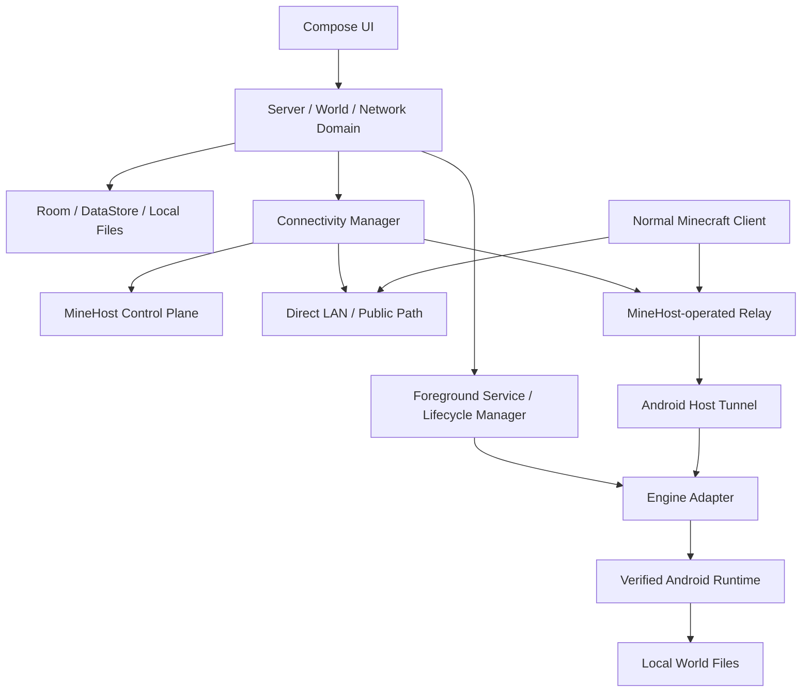

# MineHost — Architecture

> This describes the current application layers and the target product architecture. The MineHost-owned global network and native server-runtime integrations are not implemented yet.

## 1. Android application layers

- **Presentation:** Jetpack Compose, Material 3, Navigation Compose, StateFlow.
- **Domain:** server lifecycle, engine interfaces, tunnel/provider abstractions, use cases.
- **Data:** Room server metadata, DataStore preferences, repositories, app-private world/configuration files.
- **Platform:** foreground service, notification controls, wake-lock/thermal monitoring, Android network observation.
- **Execution:** server engines are abstracted behind ServerEngine. Current process-based adapters use ManagedServerProcess; a future in-process native engine may require a separate handle implementation.

## 2. High-level components

The cloud control plane is not the game server. The Android phone remains the host and source of truth for the world.

## 3. Server lifecycle

A process being alive or a port being bound is not sufficient to mark a server online. The lifecycle must be:
- NOT_CREATED -> INSTALLING -> STOPPED
- STOPPED -> STARTING -> ONLINE only after a protocol-appropriate readiness response
- STARTING -> ERROR on timeout, missing runtime, invalid configuration, or bind failure
- ONLINE -> STOPPING -> STOPPED on a requested graceful stop
- ONLINE -> CRASHED only on an unexpected process exit
- CRASHED/ERROR -> STOPPED after explicit recovery/reconciliation

Each status shown in the UI must correspond to a measured process/protocol/network fact. A tunnel process running is not proof that a public Minecraft endpoint is reachable.

## 4. Engine abstraction

The ServerEngine interface should hide engine-specific install, configure, start, stop, command, and readiness behavior. Do not assume all engines are child processes: native Go/Rust engines may need an in-process library and an engine-specific lifecycle handle.

No current engine is certified for production. See [Server Engine Status](SERVER_ENGINES.md) and [Engine Evaluation](ENGINE_EVALUATION.md).

## 5. Networking planes

- **Control plane:** host registration, authentication, session negotiation, endpoint allocation, relay selection, telemetry.
- **Data plane:** direct LAN/public traffic where reachable; MineHost-operated protocol-aware relay only when needed.
- **Java:** TCP forwarding.
- **Bedrock:** version-specific transport handling; validate required TCP/UDP behavior with real clients.

Playit remains an experimental provider adapter only and is not the target production dependency. See [Networking](NETWORKING.md).

## 6. Storage

- Server metadata: Room.
- Preferences: DataStore.
- Worlds, engine data, configuration and backups: app-private files.
- Export/import: explicit user action with integrity validation.
- Backup restore: safe save/pause, checksum validation, temporary extraction, path validation, safety snapshot and rollback-safe replacement.

Do not upload worlds without explicit user opt-in.

## 7. Security and privacy

- No root requirement.
- No arbitrary shell command execution through the Minecraft console.
- Authenticate and encrypt host-to-relay/control-plane traffic.
- Keep credentials out of logs and source control.
- Pin and verify runtime/engine assets.
- Review Google Play dynamic-code policy and all third-party licences.
