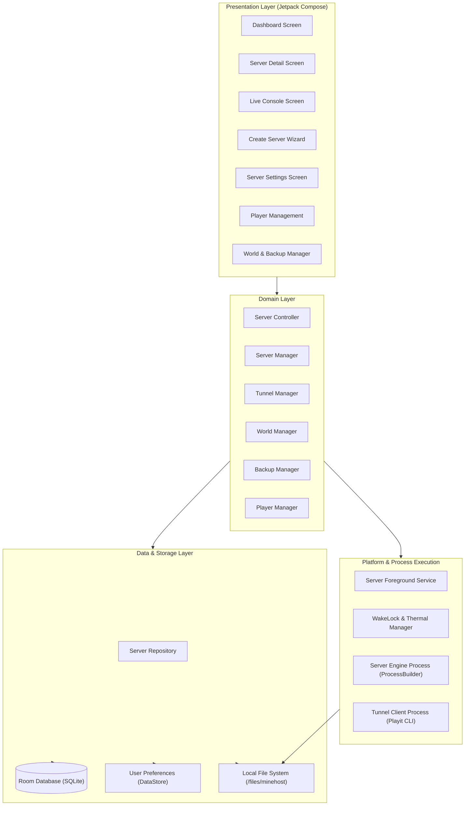
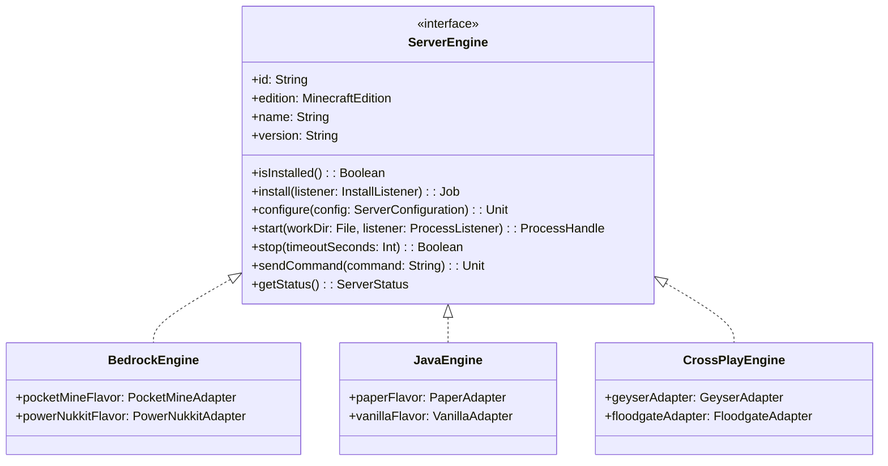
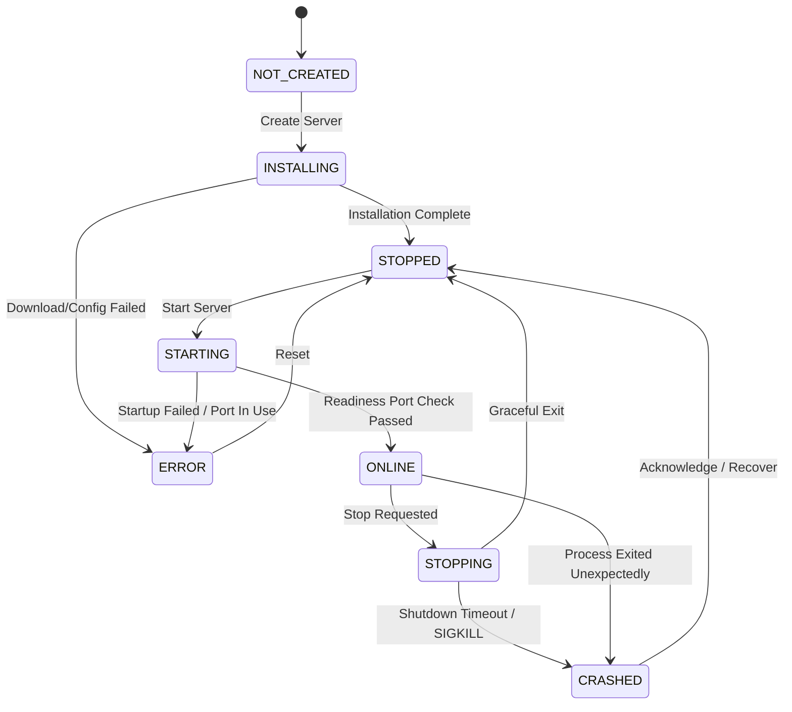
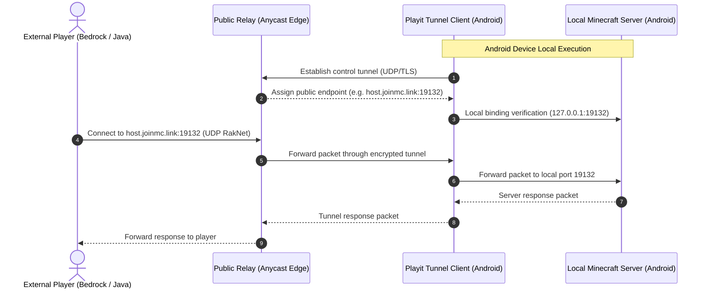

# MineHost — System Architecture Specification

## 1. Architectural Overview

MineHost is built according to **Clean Architecture** principles and the modern Android development stack:
- **Presentation:** Jetpack Compose, Material 3, Navigation Compose, unidirectional data flow (UDF) with Kotlin StateFlow.
- **Domain:** Pure business logic, Use Cases, Engine interfaces, Tunnel abstractions, and Server state machine.
- **Data:** Repository pattern, Room Database for server metadata and logs, Jetpack DataStore for preferences, and direct file I/O for Minecraft world directories and configurations.
- **Platform Services:** Android Foreground Service, WakeLock management, Thermal Status monitoring, and process supervision via `ProcessBuilder`.



---

## 2. Subsystem Breakdown

### 2.1 Server Engine Abstraction Layer
MineHost does not bind directly to any specific server software. It abstracts all engines behind `ServerEngine`:



### 2.2 Server Lifecycle State Machine
A server instance transitions through strict observable states:



### 2.3 Networking & Tunnel Architecture
External players connect across the internet without router configuration:



---

## 3. Storage Architecture

```
files/minehost/
├── servers/
│   └── <server_uuid>/
│       ├── server.json             # Server metadata & settings
│       ├── server.properties       # Minecraft vanilla server configuration
│       ├── worlds/                 # Active world save directory
│       │   └── default/
│       ├── plugins/                # Engine plugins / extensions
│       ├── logs/                   # Log history & crash reports
│       └── backups/                # Local compressed world snapshots (.zip)
├── engines/
│   ├── bedrock/                    # Bedrock engine binaries / phar files
│   └── java/                       # Java server JARs
├── runtimes/
│   └── jre/                        # Portable Java Runtime Environment
└── tunnels/
    └── playit/                     # Tunnel agent configuration & identity cache
```

---

## 4. Security & Isolation Model

1. **Local World Integrity:** All worlds and configurations are stored in private app storage (`context.filesDir`).
2. **Native Execution:** Executables adhere to Android API 29+ W^X policies by executing from `context.applicationInfo.nativeLibraryDir`.
3. **No Root Requirement:** Operates entirely within standard unprivileged Android user space.
4. **Console Shell Protection:** Command console strictly passes input to Minecraft server standard input; operating system shell commands (`/bin/sh`, PowerShell, cmd) are blocked.
5. **Relay Token Protection:** Playit authentication secret keys and sensitive tokens are encrypted using Android Keystore / EncryptedSharedPreferences.

